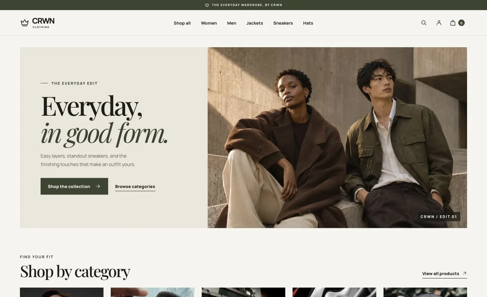
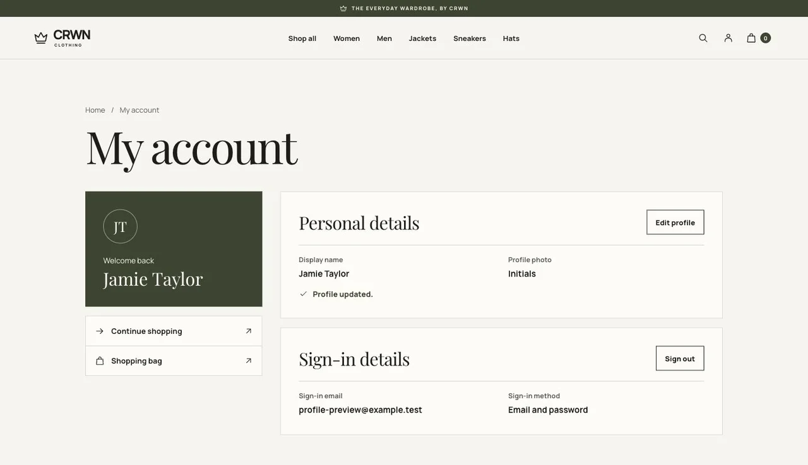

# CRWN Clothing

CRWN Clothing is a responsive fashion storefront built with React and Firebase. It covers product discovery, an account-synced shopping bag, simulated checkout, delivery and returns, with an account center and an owner catalog dashboard.

[Explore the live storefront](https://crownclothings.com/)



## Features

- Browse by category, search by product name, and combine price, size, colour, brand and availability filters in shareable URLs. Returning to the catalog restores your search, filters, and position.
- Choose a size and pictured colour before adding a product. Demonstration stock limits available sizes and quantities. Product pages include a gallery with enlarged images and detail crops, measuring instructions, illustrative size references and links to footwear brands’ size guides.
- Keep the shopping bag across devices when signed in. A guest bag is merged into the account on sign-in, with separate lines for different sizes and retry protection. Guest bags remain available in their original browser.
- Save products to a wishlist that syncs across devices through the signed-in account.
- Save multiple delivery addresses and choose a default. Checkout offers Standard and Express demo delivery, shows the delivery fee, and saves the chosen address and shipping details with the order.
- Try checkout with a preset test card. The confirmation includes a demo order reference, product options, delivery details and total. Signed-in checkout saves the receipt and updates the account bag in one transaction. Order history includes product previews, search, status filters and a buy-again action. A demo order can be cancelled while Processing, or moved through simulated dispatch and delivery before a demo return is requested.
- Sign in with Google or email and password, request a password-reset email, edit your display name, and upload an avatar or use an HTTPS photo link. Your wishlist, bag, addresses, orders and support requests are saved to your account.
- Revisit recently viewed products and browse related pieces and outfit suggestions. The help center includes product, delivery and returns guidance, a contact form and account-specific support history.
- Manage the existing 35 products through the owner dashboard at `/admin`, including names, descriptions, prices, per-size demo stock, availability and gallery image links. Catalog changes update the storefront through Firestore.



## Tech stack

React 18, React Router 6, Sass, Firebase Authentication, Cloud Firestore, and Netlify. The storefront reads the catalog from Firestore, combines it with owner-managed product overrides, and keeps a bundled catalog available for browsing. Checkout waits for current catalog data. Firebase Authentication handles sign-in and password recovery. Firestore stores account shopping data and uploaded avatar thumbnails. The homepage and product campaign images were created with OpenAI ImageGen.

## Demo scope and access

Payments, inventory quantities, delivery fees and timelines, cancellations, and returns are demonstrations. Checkout records a simulated order, and order controls let the shopper simulate dispatch and receipt. Contact and return requests are saved in the account’s support history.

Apparel and hat size tables are explicitly labelled example fit references. Product-specific garment measurements and fibre compositions still require supplier data. The campaign and detail views are AI-generated illustrations of the demo catalog; actual product photographs can be supplied through the owner dashboard.

Firestore rules in `firestore.rules` restrict bags, addresses, wishlists, order receipts, order states and support requests to the owning account. Catalog data is public to read. Catalog updates require the verified owner Google account configured in both the dashboard access check and the Firestore rules. Ordinary signed-in accounts have customer access.

Orders and shipping address snapshots remain fixed after checkout. Delivery state and support requests are stored separately. A guest receipt stays in its original browser. To migrate an older signed-in receipt that was saved locally by an earlier version, open the account center in that original browser once.

## Run locally

Use Node.js 22 or later and Yarn Classic.

```sh
git clone https://github.com/edwardxcj/CRWN-CLOTHING.git
cd CRWN-CLOTHING
yarn install --frozen-lockfile
yarn start
```

Open [localhost:3000](http://localhost:3000). To use Google sign-in on a different hostname, add it to the Firebase project's authorized domains.

```sh
CI=true yarn test --watchAll=false --runInBand
yarn build
```

With the Firebase CLI and Java installed, run the rules and commerce workflow checks against local Authentication and Firestore emulators:

```sh
firebase emulators:exec --only auth,firestore --project demo-crwn-commerce 'node --test tests/firestore-rules.test.mjs tests/commerce-workflows.test.mjs'
```

These tests require a `demo-` project ID and local emulator addresses. They cover account isolation, catalog permissions, shared account data, checkout snapshots and order/support state transitions.

## Build and deployment

`yarn build` runs the React production build and `scripts/export-pages.cjs`. The exporter reads current public catalog overrides from Firestore and writes product/category HTML with titles, canonical URLs, share images and product metadata, plus a sitemap and a custom 404 page. The export fails if the live catalog snapshot cannot be fetched, so a deployment cannot silently publish stale catalog metadata.

Owner catalog changes appear in the running storefront immediately. Search/share HTML snapshots update on the next build and deployment. Inactive products are omitted from the exported product routes and sitemap.

Disconnected emulator fixture builds can use `CRWN_QA_OFFLINE_CATALOG=1` in a scratch copy without a `.git` directory. This setting is rejected for Netlify deployments.

Netlify publishes the `build` directory. Known client routes can be opened directly, while unknown URLs use the custom 404 page with a 404 response. Deploy the matching Firestore rules when changing the stored schemas or access checks.
