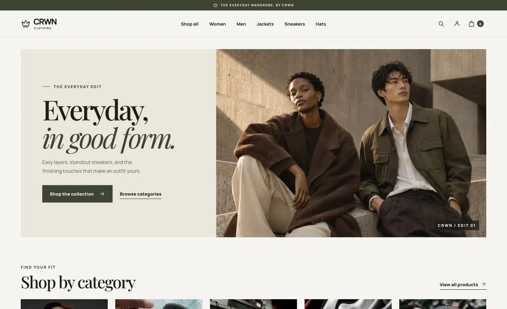
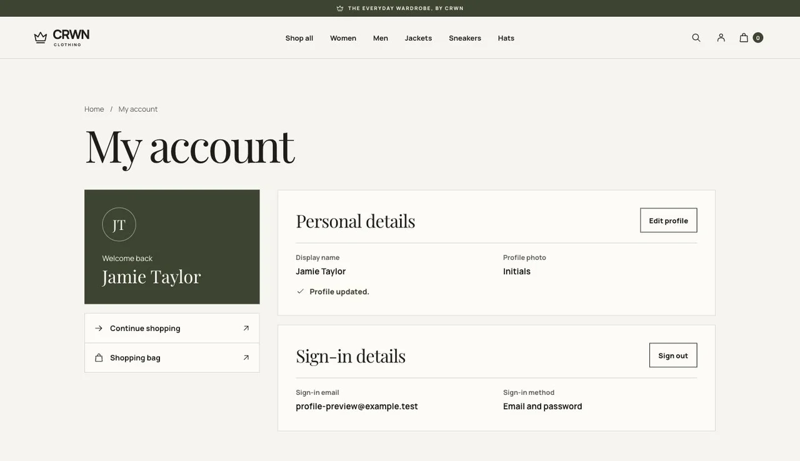

# CRWN Clothing

CRWN Clothing is a responsive fashion storefront built with React and Firebase. It covers the shopping flow from product discovery to a simulated checkout, with an account center for signed-in shoppers.

[Explore the live storefront](https://crownclothings.com/)



## Features

- Browse by category, search by product name, sort results, and open shareable product pages.
- Add products to a shopping bag, adjust quantities, and keep the bag across refreshes in the same browser.
- Try checkout with a preset test card. The confirmation shows the item count and total and clears the bag. The demo makes no charges or real orders.
- Sign in with Google or email and password. In the account center, edit your display name and set an avatar with an HTTPS image link. The sign-in email is read-only.



## Tech stack

React 18, React Router 6, Sass, Firebase Authentication, Cloud Firestore, and Netlify. The storefront reads the catalog from Firestore and uses the bundled catalog when Firestore is unavailable. Firebase Authentication saves profile changes. The homepage campaign image was created with OpenAI ImageGen.

## Run locally

Use Node.js 22 or later and Yarn Classic.

```sh
git clone https://github.com/edwardxcj/CRWN-CLOTHING.git
cd CRWN-CLOTHING
yarn install --frozen-lockfile
yarn start
```

Open [localhost:3000](http://localhost:3000). To use Google sign-in on a different hostname, add it to the Firebase project's authorized domains.

```sh
yarn test --watchAll=false
yarn build
```

Netlify publishes the `build` directory. The rewrite in `public/_redirects` lets visitors open product, category, and account URLs directly.
